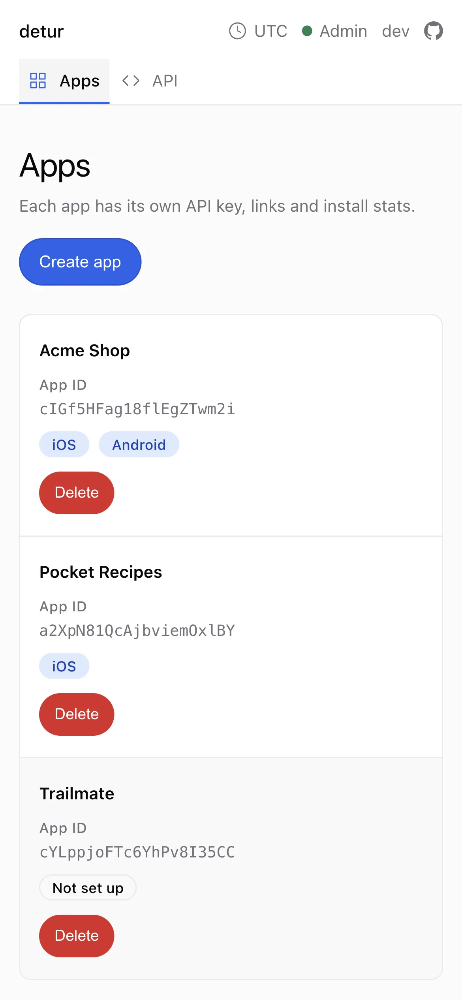
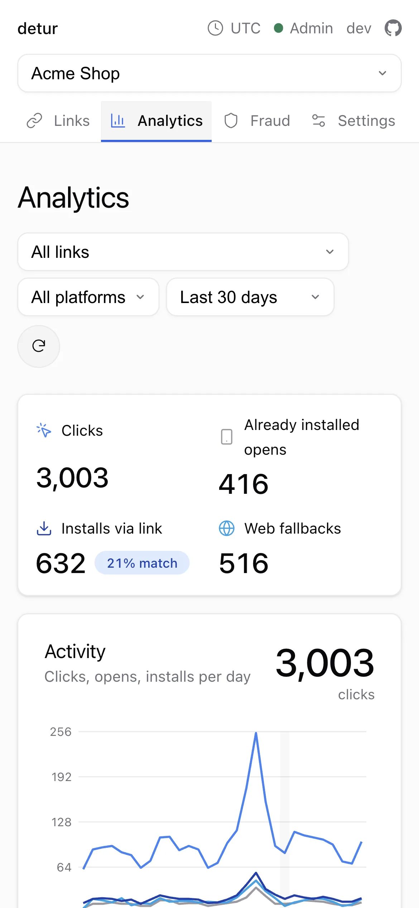
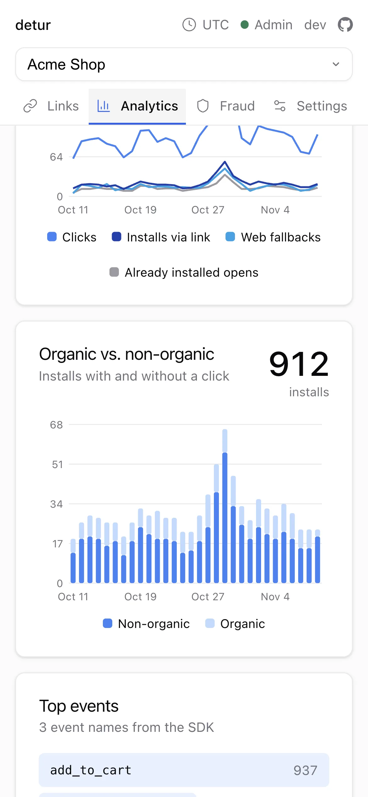
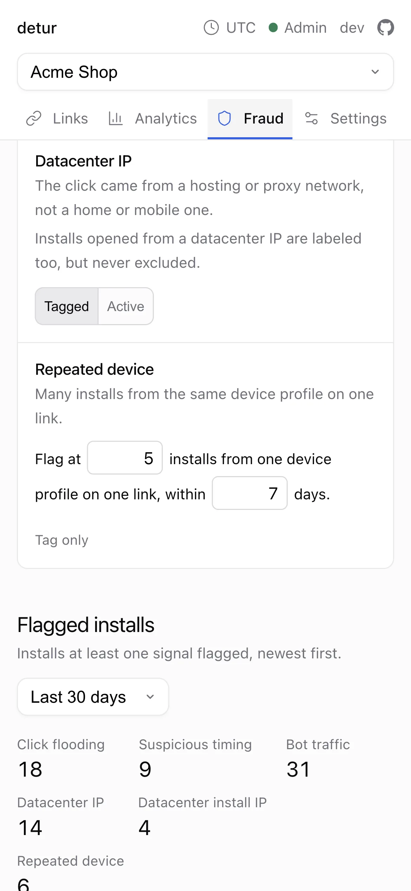
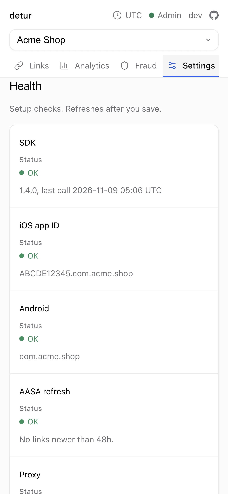

# detur

> **Built on the Detour team's work. Support them with [Detour](https://detour.swmansion.com).**

Self-hosted, drop-in [Detour](https://detour.swmansion.com) backend for its React Native, iOS, Android, and Flutter SDKs. Deferred deep links open on first launch after install; analytics track clicks, installs, and events.

- **Single binary**: Go + SQLite + Preact portal; ~30 MB RAM, <0.1 vCPU.
- **Rules & A/B**: route by platform, language, query, date; sticky weighted splits.
- **In-app browsers**: tap page → Messenger, TikTok, Zalo users never get stuck.
- **Exact iOS match**: copied link carries a one-time token → no time window.
- **Link pages**: per-link social previews; desktop QR page for app-only links.
- **Tags**: label links, filter the list by tag.
- **Fraud**: flag/block click floods, bots, datacenter IPs, repeat devices.
- **Analytics & webhooks**: per-link conversions, D1/D7/D30 retention, sub-day + link filters, HMAC-signed webhooks.
- **Data API + MCP**: read-only, per-app tokens → ask Claude/Cursor about installs, fraud, conversions.

[DECISIONS.md](DECISIONS.md) · [CAVEATS.md](CAVEATS.md)

<table>
  <tr>
    <td width="20%"></td>
    <td width="20%"></td>
    <td width="20%"></td>
    <td width="20%"></td>
    <td width="20%"></td>
  </tr>
  <tr>
    <td align="center">Apps</td>
    <td align="center">Analytics</td>
    <td align="center">Charts</td>
    <td align="center">Fraud</td>
    <td align="center">Settings</td>
  </tr>
</table>

## Quick start

> **Agent skill:** `npx skills add anh-ld/detur` ([skills/detur/](skills/detur/)) → automates steps 3–4.

### 1. Docker

```text
ghcr.io/anh-ld/detur:latest
```

```sh
docker run -d --restart unless-stopped --env-file .env \
  -v detur-data:/data \
  -p 8080:8080 -p 127.0.0.1:8081:8081 \
  ghcr.io/anh-ld/detur:0.15.1
```

- Prod: pin a version ([GitHub tags](https://github.com/anh-ld/detur/tags), no `v`).
- `-v`: no named volume → `docker rm` loses every app, key, install. Bind mount → writable by uid 1000.
- `127.0.0.1:8081`: portal has no login; bare `-p 8081:8081` → public (Docker bypasses ufw).

> Ports: `8080` (public SDK, links, `/health`) · `8081` (portal UI).

| Env | Required | Default | Description |
|---|---|---|---|
| `DOMAIN` | prod | `localhost` | Public domain |
| `DB_PATH` | no | `detur.db` (image: `/data/detur.db`) | SQLite path |
| `RETENTION_HOURS` | no | `24` | Click TTL (hours) |
| `CLICK_ID_DAYS` | no | `30` | Referrer TTL (days) |
| `TRUST_PROXY` | no | `0` | Trust reverse proxy |
| `TRUSTED_PROXIES` | no | private ranges | Trusted proxy CIDRs |
| `LOGOUT_URL` | no | empty | Sign-out URL |
| `ADMIN_PASSWORD` | no | empty | Admin password |
| `ADMIN_SESSION_HOURS` | no | `12` | Session length (hours) |
| `PORTAL_HOSTS` | gateway | empty | Portal hostnames behind a proxy |

Details → [.env.example](.env.example).

### 2. Create app

Portal: `:8081`.

- Create app; copy the API key (shown once).
- Links: `/key` → app route (`/product/42`) + optional title/note, iOS / Android / fallback.
- App details (iOS app ID, Android package, cert fingerprint) → well-known files.
- Settings → Get-app page: default, or custom HTML (`{{cta}}`, `{{icon_url}}`, …) for the iOS copy page + in-app tap page.
- API page: tokens table first, `New token` drawer, tabbed Connect guide.
- `ADMIN_PASSWORD` set → app changes need admin (top bar "Enter admin"); gated buttons stay locked until then.

### 3. Point SDK at detur

Every Detour SDK hardcodes 5 `https://godetour.dev/api/...` URLs. Swap the host, keep the paths.

| SDK | URLs in | Persist via |
|---|---|---|
| [React Native](https://detour.swmansion.com/docs/sdk/react-native/sdk-installation/) | `src/` + `lib/module/` | `patch-package` + `postinstall`, or `bun patch` |
| [iOS](https://detour.swmansion.com/docs/sdk/ios/sdk-installation/) | `Sources/Detour/DetourConstants.swift` | Fork → SPM URL or `pod 'Detour', :git =>` |
| [Android](https://detour.swmansion.com/docs/sdk/android/sdk-installation/) | `detour-sdk/.../api/*ApiClient.kt` | Fork → `includeBuild` substituting `detour-sdk` |
| [Flutter](https://detour.swmansion.com/docs/sdk/flutter/sdk-installation/) | iOS + Android SDKs (bridge) | Both forks: `ios/Podfile`, `android/settings.gradle` |

Base URL: simulator `http://localhost:8080` · Android emulator `http://10.0.2.2:8080` · device → host LAN IP · prod `https://<DOMAIN>`.

Give your AI agent:

```text
Point this app's Detour SDK at my detur server. BASE_URL=<url>.

1. Detect SDK: React Native, iOS, Android, or Flutter (→ its iOS + Android SDKs).
2. Replace https://godetour.dev with BASE_URL in the 5 endpoint URLs
   (RN: src/ and lib/module/). Keep /api/... paths.
3. Persist per the detur README step 3 table.
4. Verify: "godetour.dev" left only in author/homepage metadata.
5. Report changed files + persistence.
```

Example (React Native 2.3.1): [example/patch/](example/patch/).

### 4. Wire app

Follow your SDK's Detour docs, swapping in:

- **Credentials:** `appID` + `apiKey` from the portal; keep out of git.
- **Link host:** your domain. iOS `applinks:<DOMAIN>` · Android `autoVerify` intent filter `host="<DOMAIN>"` · Expo `+native-intent.tsx` `hosts`.

detur serves `apple-app-site-association` + `assetlinks.json` from app details (step 2).

Example (Expo): [example/expo-app/](example/expo-app/).

### 5. Data API + MCP (optional)

Needs `ADMIN_PASSWORD`. Portal → API → create token, pick apps (token shown once; page has copyable setup).

Any MCP client (Claude, Cursor, Codex, VS Code, …): remote Streamable HTTP server.

```json
{ "mcpServers": { "detur": { "type": "http", "url": "https://<DOMAIN>/api/mcp", "headers": { "Authorization": "Bearer dtr_..." } } } }
```

```sh
curl -H "Authorization: Bearer dtr_..." "https://<DOMAIN>/api/v1/apps/<id>/analytics?days=7"
```

Read-only: apps, links (with title/note/tags), rules, variants, analytics (ranges, sub-day `window=15m|1h|3h|12h`, link filters; window mode has no conversions/retention), match quality, fraud counts, health.

## Dev run

Prerequisites: Go 1.27, Bun 1.4.4.

```sh
./dev.sh
```

- Portal HMR `:8000` + Go reload via [air](https://github.com/air-verse/air).
- Portal rules live once: admin gate + load guard `portal/src/lib/admin.ts`, URLs `portal/src/lib/route.ts`, link draft `portal/src/pages/app/links/link-draft.ts`. Layout: `lib/` (no JSX), `components/` (shared UI), `pages/` (one folder per screen).
- Tests: `cd server && go test ./...` · `cd portal && bun run test` (stop any running `detur` first: tests bind `:8080`)

## Credits

- [dub.sh](https://dub.sh): link-funnel server logic.
- [Detour matching docs](https://detour.swmansion.com/docs/platform/architecture/matching/): weights, threshold, window.
- Detour SDKs: [React Native](https://github.com/software-mansion-labs/react-native-detour), [iOS](https://github.com/software-mansion-labs/ios-detour), [Android](https://github.com/software-mansion-labs/android-detour), [Flutter](https://github.com/software-mansion-labs/flutter-detour).
- [Seline](https://seline.com): portal design.
